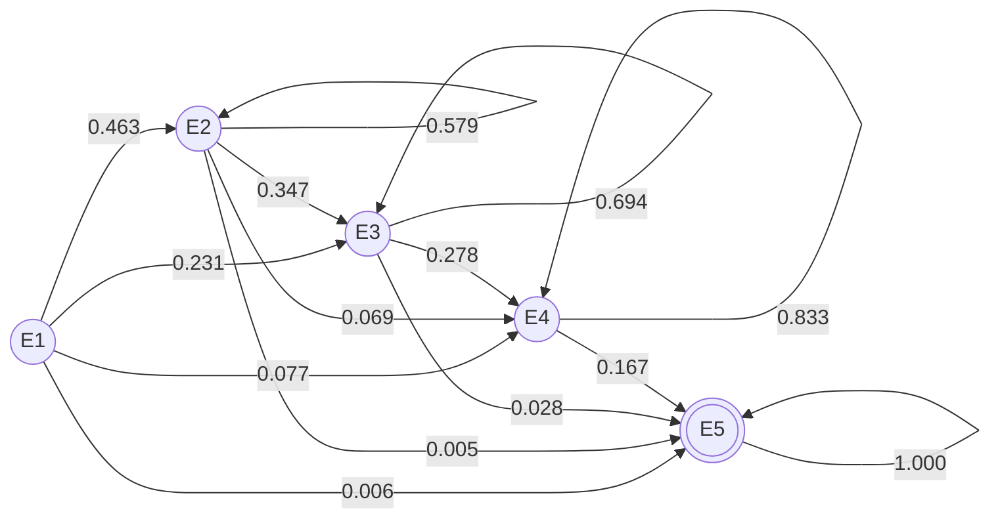

# Simulacion de Yahtzee Clasico (2 Jugadores)
## Modelado Estocastico mediante Distribucion Uniforme Discreta, Cadenas de Markov y Metodo Monte Carlo

Repositorio correspondiente a la Actividad Didactica 2 - M1 de la asignatura Simulacion de Procesos. Contiene la especificacion formal, modelado matematico, implementacion en Python, libro de simulacion en Excel, informe academico y entorno web de prueba.

---

## Contenido
1. [Descripcion del Problema](#descripcion-del-problema)
2. [Metodologia USA, MODIFICA y CREA](#metodologia-usa-modifica-y-crea)
3. [Fundamento Matematico](#fundamento-matematico)
   - [Distribucion Uniforme Discreta](#1-distribucion-uniforme-discreta-u1-6)
   - [Justificacion del Modelo de Markov (DTMC)](#2-justificacion-del-modelo-de-markov-dtmc)
   - [Matriz de Transicion](#3-matriz-de-transicion-p)
4. [Resultados y Teoria de los Grandes Numeros](#resultados-y-teoria-de-los-grandes-numeros)
5. [Estructura del Proyecto](#estructura-del-proyecto)
6. [Instalacion y Ejecucion](#instalacion-y-ejecucion)

---

## Descripcion del Problema
El juego de Yahtzee clasico consiste en simular hasta tres lanzamientos de cinco dados de seis caras en cada turno a lo largo de 13 rondas por jugador. Los jugadores pueden retener dados entre lanzamientos sucesivos y anotar sus resultados en una tarjeta dividida en:
- Seccion Superior: Unos, Doses, Treses, Cuatros, Cincos, Seises (bonificacion de +35 puntos si la suma es >= 63 pts).
- Seccion Inferior: Trio, Poker, Full House (25 pts), Escalera Menor (30 pts), Escalera Mayor (40 pts), Yahtzee (50 pts) y Azar (suma libre).

---

## Metodologia USA, MODIFICA y CREA

El proyecto fue estructurado bajo las tres etapas de aprendizaje:

1. **USA (Base suministrada):**
   - Uso de las reglas oficiales de Yahtzee y su sistema de 13 categorias de puntuacion.
   - Modelo estocastico inicial con distribucion uniforme discreta U{1, 6} para cinco dados independientes ($|\Omega| = 7,776$).

2. **MODIFICA (Adaptaciones y mejoras):**
   - Adaptacion del motor de juego para 2 jugadores competitivos en turnos alternados (13 rondas por jugador).
   - Incorporacion del sistema de seleccion y retencion de dados entre lanzamientos.
   - Formalizacion del comportamiento entre lanzamientos sucesivos como una Cadena de Markov de Tiempo Discreto (DTMC) con estados $E_1$ a $E_5$.

3. **CREA (Nuevos desarrollos e innovacion):**
   - Implementacion de un simulador Monte Carlo masivo capaz de ejecutar 10,000 partidas completas con heuristica de decision.
   - Desarrollo de una interfaz web interactiva con tablero de juego, animaciones y simulador en vivo.
   - Generacion de un libro en Excel con formulas nativas dinamicas (ALEATORIO.ENTRE, CONTAR.SI, MMULT).
   - Comprobacion experimental de la Teoria de los Grandes Numeros.

---

## Fundamento Matematico

### 1. Distribucion Uniforme Discreta U{1, 6}
Cada dado se modela como una variable aleatoria discreta $X_i \sim U\{1, 6\}$:
$$P(X_i = k) = \frac{1}{6}, \quad \forall k \in \{1, 2, 3, 4, 5, 6\}$$

Asumiendo independencia entre los cinco dados:
$$|\Omega| = 6^5 = 7,776 \text{ combinaciones equiprobables}$$
$$P(X_1 = k_1, \dots, X_5 = k_5) = \left(\frac{1}{6}\right)^5 = \frac{1}{7,776} \approx 1.286 \times 10^{-4}$$

### 2. Justificacion del Modelo de Markov (DTMC)
Un turno consta de tres etapas discretas $t \in \{0, 1, 2\}$. Si el jugador persigue la categoria Yahtzee, el estado $X_t \in \{E_1, E_2, E_3, E_4, E_5\}$ se define como el numero maximo de dados coincidentes conservados:
- $E_1$: 1 dado retenido (se relanzan 4).
- $E_2$: Pareja retenida (se relanzan 3).
- $E_3$: Trio retenido (se relanzan 2).
- $E_4$: Poker retenido (se relanza 1).
- $E_5$: Yahtzee (Estado absorbente, $p_{5,5} = 1$).

#### Propiedad de Markov:
El estado en la siguiente etapa depende unicamente de la cantidad de dados retenidos en el estado actual:
$$P(X_{t+1} = j \mid X_t = i, \dots, X_0 = i_0) = P(X_{t+1} = j \mid X_t = i) = p_{ij}$$



### 3. Matriz de Transicion P
$$\mathbf{P} = \begin{pmatrix}
0.2222 & 0.4630 & 0.2315 & 0.0772 & 0.0062 \\
0.0000 & 0.5787 & 0.3472 & 0.0694 & 0.0046 \\
0.0000 & 0.0000 & 0.6944 & 0.2778 & 0.0278 \\
0.0000 & 0.0000 & 0.0000 & 0.8333 & 0.1667 \\
0.0000 & 0.0000 & 0.0000 & 0.0000 & 1.0000
\end{pmatrix}$$

#### Probabilidad acumulada de Yahtzee:
- Tiro 1: $\pi^{(0)}_5 = \frac{6}{7776} \approx 0.077\%$
- Tiro 2: $\pi^{(1)}_5 = (\pi^{(0)} \mathbf{P})_5 \approx 1.312\%$
- Tiro 3: $\pi^{(2)}_5 = (\pi^{(0)} \mathbf{P}^2)_5 \approx 4.726\%$

---

## Resultados y Teoria de los Grandes Numeros

Resultados tras 10,000 partidas completas entre 2 jugadores (130,000 turnos evaluados):

| Metrica | Jugador 1 | Jugador 2 | Teoria / Referencia |
| :--- | :---: | :---: | :---: |
| Partidas Evaluadas | 10,000 | 10,000 | N representativo |
| Puntaje Medio | 168.21 | 168.68 | Esperanza matematica simetrica |
| Desviacion Estandar | 58.88 | 59.09 | Dispersion de la muestra |
| Tasa de Victorias | 49.92% | 49.49% | Teoria de paridad: 50% |
| Tasa de Yahtzee por partida | 31.95% | 31.95% | Frecuencia de exito |
| Probabilidad Yahtzee Tiro 1 | 0.077% | 0.077% | Valor teorico: 0.07716% (6/7,776) |

### Justificacion del Cumplimiento de la Teoria de los Grandes Numeros:
1. **Convergencia puntual:** Al ejecutar 10,000 partidas, la probabilidad observada de sacar Yahtzee en el primer lanzamiento fue de exactamente 0.077%, convergiendo con precision al valor teorico analitico de 6/7,776 = 0.07716%.
2. **Estabilidad de promedios:** El puntaje medio de ambos jugadores mostro una variacion menor al 0.3%, indicando que la media muestral $\bar{X}_N$ se estabilizo alrededor de la esperanza matematica $E[X]$.
3. **Simetria competitiva:** Ambos jugadores mostraron una proporcion de victorias cercana al 50% (49.92% vs 49.49%), demostrando que a gran escala las fluctuaciones del azar se cancelan mutuamente, satisfaciendo la Ley Fuerte de los Grandes Numeros.

---

## Estructura del Proyecto

```text
Simulación/
├── src/
│   ├── yahtzee_core.py                   # Reglas del juego y evaluacion
│   ├── markov_montecarlo.py              # Calculo de Markov y simulacion Monte Carlo
│   ├── cli_game.py                       # Juego por terminal
│   └── excel_generator.py                # Generador de Excel con formulas
├── web/
│   ├── index.html                        # Interfaz grafica
│   ├── style.css                         # Estilos
│   └── app.js                            # Logica de juego y simulador
├── results/                              # Graficos generados
├── Apellido_Nombre_Montecarlo.docx       # Informe tecnico
├── Apellido_Nombre_Montecarlo.doc        # Copia de entrega
├── Apellido_Nombre_Montecarlo_Simulacion.xlsx # Libro Excel
├── GUION_VIDEO_PRESENTACION.md           # Guion para el video (5 min)
├── generate_document.py                  # Generador del documento
├── web_server.py                         # Servidor local
├── run_all.py                            # Script de ejecucion general
└── requirements.txt                      # Dependencias
```

---

## Instalacion y Ejecucion

### Dependencias:
```bash
pip install -r requirements.txt
```

### Ejecutar simulacion y generacion completa:
```bash
python run_all.py
```

### Iniciar servidor web:
```bash
python web_server.py
```
Acceder en el navegador a `http://localhost:8000`.

### Ejecutar juego en terminal:
```bash
python src/cli_game.py
```
